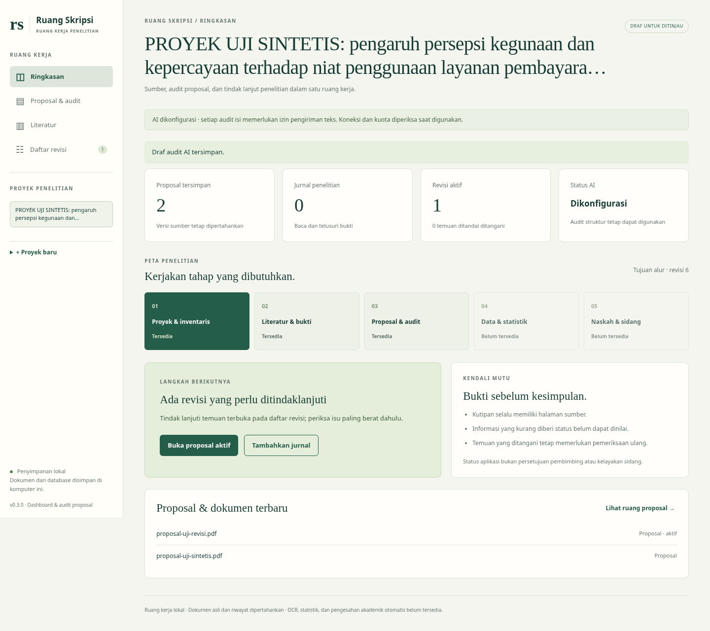

# Ruang Skripsi — Asisten Skripsi S1

**Versi 0.3.0: dashboard penelitian dan audit proposal.** Ruang kerja memiliki menu Ringkasan, Proposal & audit, Literatur, dan Daftar revisi. [Spesifikasi revisi 6](docs/revisi6/README.md) menjadi acuan pengembangan; modul data/statistik dan naskah/sidang masih ditandai belum tersedia.

Alur yang berjalan: **proyek → proposal/pedoman → pembacaan halaman → pemeriksaan struktur → draf audit berbukti → tindak lanjut revisi**. Alur jurnal dan tinjauan pengguna yang sudah ada tetap tersedia. [Detail implementasi dan batas audit proposal](docs/revisi6/implementasi-proposal.md).



Gambar memakai proyek sintetis dan penyedia AI tiruan untuk validasi antarmuka; bukan hasil penelitian nyata. Instalasi tanpa kunci menampilkan AI belum dikonfigurasi.

## Menjalankan

Python **3.11+**. SQLite tersedia dalam Python; dependency aplikasi hanya `pypdf` (versi dipatok di `requirements.txt`).

```sh
cd /workspace/aggent-skripsis-s1  # atau lokasi checkout Anda
python3 -m venv .venv
.venv/bin/python -m pip install -r requirements.txt
.venv/bin/python -m unittest discover -s tests -v
.venv/bin/python app.py --port 8000
```

Gunakan browser lokal pada alamat loopback port 8000. Hentikan dengan Ctrl+C. Jika port terpakai, hentikan server lama milik Anda atau pilih `--port 8001`. Windows: ganti `.venv/bin/python` dengan `.venv\Scripts\python.exe`.

### Windows PowerShell / VS Code

Buka folder yang berisi `app.py` **dan** `requirements.txt`, lalu jalankan satu per satu. Tidak perlu aktivasi virtual environment:

```powershell
py -m venv .venv
.\.venv\Scripts\python.exe -m pip install -r requirements.txt
.\.venv\Scripts\python.exe -m unittest discover -s tests -v
.\.venv\Scripts\python.exe app.py --port 8000
```

Jika `requirements.txt` tidak ditemukan dan hanya empat tes berjalan, folder tersebut masih versi awal atau terminal berada di folder yang salah. Perubahan pada workspace cloud tidak otomatis masuk ke ZIP GitHub; gunakan paket versi terbaru atau perubahan yang sudah dipublikasikan ke repositori. Notice pembaruan pip bukan kegagalan instalasi. Hentikan server lama dengan Ctrl+C sebelum menjalankan server baru pada port yang sama.

Koneksi SQLite ditutup setelah setiap transaksi, termasuk ketika operasi gagal, agar Windows dapat melepaskan berkas database. Jika memiliki data dari versi lama, pertahankan folder lama dan cadangkan seluruh direktori `data`; jangan menimpa data dengan folder contoh.

Secara bawaan, database ada di `data/projects.sqlite3` dan PDF asli di `data/documents/<UUID>.pdf`. Direktori ini diabaikan Git. Untuk benar-benar memisahkan data dari checkout, jalankan dengan `--data-dir ../skripsi-data`. Cadangkan seluruh direktori data, bukan hanya database; jangan menghapusnya saat restart. PDF yang diunggah ulang menjadi dokumen baru; sumber lama tidak ditimpa.

## Dashboard dan audit proposal

1. Buat/pilih proyek. Ringkasan menampilkan jumlah proposal/jurnal, revisi aktif, status AI, dan langkah berikutnya berdasarkan data proyek.
2. Buka **Proposal & audit**. Pilih jenis **Proposal penelitian**, lalu unggah PDF. Proposal terakhir menjadi aktif; versi lama dan auditnya dipertahankan sebagai riwayat.
3. Pilih **Periksa struktur tanpa AI**. Aplikasi mengenali calon heading Bab I–III dan halaman yang belum terbaca. Daftar isi bisa ikut terdeteksi; ini bukan penilaian mutu isi atau kepastian batas bab.
4. Bila tersedia, unggah **Pedoman kampus** pada proyek yang sama. Pilih pedoman yang memang ingin disertakan dalam audit (maksimal lima).
5. Dengan AI dikonfigurasi, setujui pengiriman teks lalu pilih **Audit substantif dengan AI**. Sepuluh kriteria diperiksa pada snapshot sumber yang sama. Hasil merupakan draf untuk tinjauan manusia; kutipan yang tidak cocok ditolak. Tanpa pedoman, kepatuhan kampus tetap belum dapat dinilai. Isi jurnal asli tidak disertakan dalam audit proposal ini, sehingga dukungan isi literatur tidak dinyatakan telah terverifikasi.
6. Tanpa AI, Anda tetap dapat memakai **Catat temuan manual dengan bukti**. Isi temuan, tindak lanjut, kutipan persis, dan halaman. Untuk temuan kepatuhan, sertakan juga kutipan aturan dari pedoman.
7. Buka **Daftar revisi**. Catat status terbuka/sedang dikerjakan/ditandai ditangani, nama pencatat, dan alasan. Riwayat tidak ditimpa. Ditandai ditangani belum berarti masalah terverifikasi selesai; audit ulang dapat membuka temuan yang sama kembali.

Versi aplikasi tampil di bagian bawah sidebar dan `/api/health`. Saat startup terminal juga menampilkan **v0.3.0** dan folder aplikasi. Jika halaman mendeteksi server lama, hentikan server dengan Ctrl+C lalu jalankan dari folder terbaru. Perbarui semua berkas aplikasi, termasuk `journal.js`, `proposal-ui.js`, `proposal.py`, dan `proposal_store.py`; jangan hanya mengganti HTML.

## Alur jurnal yang tetap tersedia

1. Buat atau pilih proyek penelitian.
2. Unggah PDF jurnal. Pilih dokumen dan halaman untuk membaca teks. Unduh sumber asli untuk memeriksa tabel, kolom, atau urutan teks.
3. Halaman tanpa teks diberi status **perlu OCR**, halaman gagal diberi penanda kegagalan. Aplikasi tidak mengklaim halaman tersebut telah dibaca.
4. Jika AI dikonfigurasi, setujui pengiriman teks jurnal ke OpenAI lalu pilih **Analisis jurnal**. Hanya halaman terbaca yang dikirim; dokumen tidak dikirim sebelum tindakan ini.
5. Tinjau tujuan, metode, sampel, temuan, dan keterbatasan. Setiap klaim harus punya kutipan dan nomor halaman PDF. Tombol bukti membuka halaman sumber. Informasi yang tidak ditemukan ditandai; hasil AI selalu disimpan sebagai draf.
6. Isi **Tinjauan bukti oleh pengguna** untuk kelima bagian, nama peninjau, dan alasan. Pilih dukungan bukti, perlu revisi, atau belum dapat dinilai. Catatan ini tersimpan untuk ID analisis dan versi sumber tertentu; bukan persetujuan pembimbing atau identitas yang telah diverifikasi.

Bagian yang tidak ditemukan hanya dapat ditandai telah diperiksa pada teks terbaca, bukan didukung sebagai temuan. Satu bagian perlu revisi membuat status keseluruhan perlu revisi; satu bagian belum dapat dinilai menahan status tinjauan lengkap. Jika ada halaman tidak terbaca, status tetap **tinjauan parsial**. Analisis ulang memerlukan tinjauan baru, dan seluruh riwayat dipertahankan.

Database lama diperbarui secara aditif saat startup. Proyek/PDF/analisis lama tidak dihapus. Analisis lama tanpa fingerprint ekstraksi tetap dapat dibaca, tetapi perlu analisis ulang sebelum menerima catatan tinjauan versi baru. Unggahan PDF baru tetap merupakan dokumen terpisah; aplikasi belum menyediakan penggantian versi dokumen melalui UI.

Status ekstraksi, checksum SHA-256, teks, halaman, waktu, model, versi prompt, cakupan halaman, dan riwayat analisis disimpan. PDF asli tetap utuh. Nomor halaman adalah urutan fisik PDF (mulai 1), **bukan** nomor tercetak. Artikel yang metadata penerbitnya belum diverifikasi tidak dianggap sudah diverifikasi hanya karena PDF berhasil dibaca.

## AI opsional: hanya di backend

Tanpa kredensial, statusnya **belum dikonfigurasi**, tombol analisis tidak aktif, dan API tidak menghasilkan jawaban contoh. Proyek, PDF, pembacaan, pemeriksaan struktur proposal, dan temuan manual tetap berfungsi.

Atur `SKRIPSI_AI_API_KEY` melalui pengelola secret/variabel proses server sebelum startup. `OPENAI_API_KEY` yang sudah disediakan server juga dapat dipakai sebagai fallback. Jangan menaruh nilai kunci di HTML, JavaScript, Git, atau perintah yang masuk riwayat shell. Aplikasi tidak otomatis membaca `.env`.

- `SKRIPSI_AI_MODEL`: opsional, default `gpt-4.1-mini`. Model harus mendukung Chat Completions dengan structured output JSON schema.
- Tujuan HTTPS: `api.openai.com`, endpoint `/v1/chat/completions`. Buka domain ini pada pengaturan jaringan lingkungan jika dibatasi.
- Status “dikonfigurasi” hanya menunjukkan kunci tersedia; koneksi, kuota, dan kompatibilitas model baru diketahui saat permintaan nyata.
- Maksimal 100.000 karakter teks per permintaan; tidak ada pemotongan tersembunyi atau retry berbiaya otomatis. Kesalahan penyedia ditampilkan sebagai kegagalan, bukan temuan penelitian.
- Setiap klaim diperiksa agar kutipannya benar-benar muncul pada halaman yang disebut (perbedaan whitespace diizinkan). Jawaban dengan kutipan rekaan/halaman salah ditolak seluruhnya. **Kecocokan teks tidak membuktikan bahwa makna klaim didukung**; pemeriksaan manusia tetap diperlukan.
- Teks dokumen diperlakukan sebagai masukan tidak tepercaya, bukan instruksi sistem. Model tidak diberi alat untuk mengeksekusi kode atau membuka tautan.

Tidak ada analisis AI nyata yang diklaim telah diverifikasi pada lingkungan tanpa kunci. Mock dalam pengujian hanya memeriksa kontrak integrasi dan ditandai sebagai model uji.

## Dokumen uji dan pengujian

```sh
.venv/bin/python scripts/make_test_pdf.py /tmp/jurnal-uji-sintetis.pdf
.venv/bin/python -m unittest discover -s tests -v
```

Generator membuat PDF dua halaman berlabel **SYNTHETIC TEST DOCUMENT — NOT A REAL JOURNAL**. Ini bahan uji, bukan artikel atau hasil penelitian nyata. Halaman 1 memiliki tujuan, metode, dan sampel; halaman 2 memiliki temuan. Keterbatasan sengaja tidak disediakan sebagai hasil penelitian. Unggah PDF ini untuk menguji pembaca secara manual.

Suite 61 pengujian mencakup alur HTTP dan penyimpanan, PDF rusak/terenkripsi, halaman kosong/parsial, batas ukuran/halaman, pemisahan dokumen proyek, persetujuan pengiriman teks, status tanpa AI, kontrak penyedia dengan mock, kutipan salah, tinjauan manusia, konflik versi, migrasi database, dashboard, audit proposal, temuan/tindak lanjut revisi, dan riwayat analisis. Lihat [catatan validasi](docs/validasi-alur-pertama.md) dan [penerapan revisi 6](docs/revisi6/implementasi-jurnal.md) untuk hasil dan batas pengujian.

Pemeriksaan browser opsional tersedia di `scripts/browser_smoke.py`. Pasang `playwright==1.62.0` ke environment pengujian dan sediakan Chromium sistem atau browser dari `python -m playwright install chromium`, lalu jalankan `python scripts/browser_smoke.py` dari checkout. Pengujian ini memakai database sementara dan AI tiruan, tanpa panggilan penyedia nyata; memeriksa lima bagian, status tidak ditemukan, tautan bukti, riwayat setelah reload, dan tampilan ponsel.

## Struktur teknis

- `app.py`: server HTTP lokal dan validasi permintaan/unggahan.
- `storage.py`: SQLite, PDF asli, dan versi hasil analisis.
- `pdf_reader.py`: proses ekstraksi terpisah dengan batas waktu/sumber daya.
- `analysis.py`: integrasi OpenAI di server, schema hasil, pemeriksaan kutipan.
- `reviews.py`: keputusan tinjauan jurnal per bagian dan pemeriksaan snapshot sumber.
- `proposal.py`: calon heading, rubrik audit, dan validasi bukti proposal/pedoman.
- `proposal_store.py`: snapshot audit, proposal aktif, isu stabil dan riwayat tindak lanjut.
- `index.html`, `app.js`, `journal.js`, `proposal-ui.js`, `style.css`: dashboard dan ruang kerja tanpa framework atau build frontend.

Struktur sederhana ini mempertahankan proyek yang sudah ada dan mudah diuji. Endpoint utama: `POST/GET /api/projects`, `POST/GET /api/projects/{id}/documents`, `GET /api/documents/{id}`, `GET /api/documents/{id}/pdf`, `POST /api/documents/{id}/analyze` (JSON `{"consent":true}`), `POST /api/documents/{id}/reviews`, serta `GET /api/ai/status`. Upload memakai body PDF langsung, `Content-Type: application/pdf`, dan header `X-Filename` yang di-encode URL; tidak memakai multipart. Review mengirim ID analisis, fingerprint PDF/ekstraksi, peninjau, catatan, serta keputusan kelima bagian. Formulir dengan versi lama ditolak HTTP 409.

## Dokumen uji proposal dan pemeriksaan browser

```sh
.venv/bin/python scripts/make_test_pdf.py /tmp/proposal-uji.pdf --kind proposal
.venv/bin/python scripts/make_test_pdf.py /tmp/pedoman-uji.pdf --kind guideline
```

Semua dokumen tersebut berlabel sintetis, bukan proposal nyata atau aturan kampus. Pemeriksaan browser opsional (memerlukan Playwright/Chromium sesuai instruksi sebelumnya):

```sh
python scripts/browser_smoke.py
python scripts/browser_workspace_smoke.py
```

API baru: `GET /api/projects/{id}/dashboard`, `GET /api/projects/{id}/issues`, `GET /api/documents/{id}/proposal`, `POST /api/documents/{id}/proposal/audits`, `POST /api/documents/{id}/proposal/issues`, serta `POST /api/issues/{id}/events`. Upload memakai header `X-Document-Kind: journal|proposal|guideline` (default journal untuk kompatibilitas). [Kontrak audit dan isu](docs/revisi6/implementasi-proposal.md).

Dokumen lama tanpa metadata jenis tetap dianggap jurnal agar klasifikasi lama tidak diubah diam-diam. Jika PDF lama sebenarnya proposal, unggah kembali dengan jenis Proposal penelitian. Semua data lama tetap tersimpan.

## Batas kemampuan

PDF maksimal **15 MiB, 100 halaman, 1 juta karakter ekstraksi**; ekstraksi maksimal 30 detik (CPU 20 detik dan memori 512 MiB pada Linux), dua pemrosesan dokumen/analisis sekaligus. PDF terenkripsi ditolak. OCR, pembacaan tabel/gambar secara visual, verifikasi DOI, pencarian jurnal, sintesis banyak jurnal, modul statistik, penulisan Bab I–V, dan ekspor DOCX belum tersedia.

Server mengikat loopback, menolak host/origin asing, dan membatasi unggahan, tetapi tetap **prototipe lokal**, belum layanan publik/multi-pengguna. Belum ada autentikasi, antivirus/sandbox keamanan PDF lengkap, atau pengelolaan akun. Jangan gunakan untuk deployment publik atau data responden sensitif. Keputusan akademik tetap memerlukan bukti dan persetujuan yang relevan.
