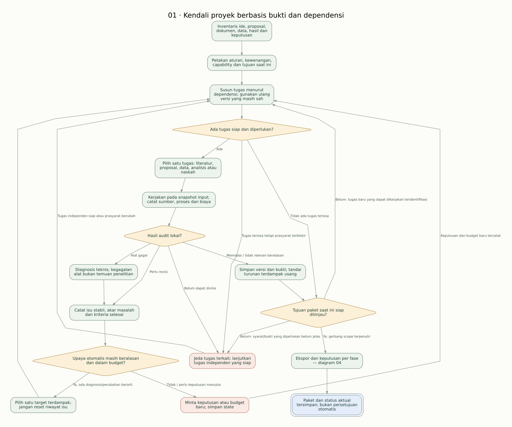

# Alur agent skripsi kuantitatif — revisi 6

Revisi ini memperkuat diagram revisi 5 sebagai **spesifikasi tujuan produk**, bukan klaim bahwa semua modul sudah diimplementasikan. Aplikasi v0.3.0 mencakup dashboard, proyek, PDF, teks per halaman, analisis/tinjauan jurnal, serta pemeriksaan struktur dan draf audit proposal dengan daftar revisi. Lihat [implementasi jurnal](implementasi-jurnal.md) dan [implementasi proposal](implementasi-proposal.md) untuk membedakan kemampuan yang tersedia dan rencana berikutnya.

Tujuannya ialah menghasilkan pekerjaan yang dapat dilacak, diperiksa, diulang, dan dipertanggungjawabkan. Diagram tidak menjamin nilai, persetujuan pembimbing, orisinalitas absolut, atau kebenaran metodologis otomatis.

## Baca mulai dari sini

1. [Audit revisi 5](audit-revisi5.md): celah logika dan koreksinya dengan ID simpul asal.
2. [Spesifikasi revisi 6](spesifikasi.md): kontrak status, gerbang, bukti, keputusan, dan penerimaan.
3. [Hasil validasi](validasi.md): apa yang sudah diperiksa dan batas kesimpulannya.
4. Diagram berikut memecah alur agar dapat dibaca tanpa satu gambar sangat panjang.

| Diagram | Fokus | SVG | Sumber Mermaid |
|---|---|---|---|
| 01 | Inventaris, penjadwalan berbasis dependensi, dan kendali kegagalan | [Buka](01-kendali.svg) | [Buka](01-kendali.mmd) |
| 02 | Audit dan penguatan proposal, termasuk penggabungan audit paralel | [Buka](02-proposal.svg) | [Buka](02-proposal.mmd) |
| 03 | Data, izin, rencana analisis, modul tervalidasi, dan interpretasi | [Buka](03-pelaksanaan.svg) | [Buka](03-pelaksanaan.mmd) |
| 04 | Ekspor dan keputusan akademik yang terpisah per fase | [Buka](04-tinjauan.svg) | [Buka](04-tinjauan.mmd) |

SVG dapat dilihat langsung di GitHub atau diunduh dengan tombol **Raw / Download raw file**. Sumber [revisi 5](sumber-revisi5.svg) disimpan utuh untuk membandingkan perubahan.



Hijau: pekerjaan. Kuning: keputusan/gerbang. Merah muda: jeda tugas terkait. Biru: keluaran atau status akhir pada lingkup diagram. Ungu: pemisahan audit yang memerlukan penggabungan seluruh hasil yang berlaku.

## Prinsip utama

- Masuk dari kondisi nyata: ide, proposal, data, analisis eksternal, atau naskah. Kondisi dapat tersedia bersamaan; pekerjaan yang masih sah digunakan kembali.
- Tiga pemeriksaan dibedakan: perangkat berhasil, bukti sesuai, dan keputusan akademik oleh aktor yang berwenang.
- Bukti hilang/gagal dibaca berarti belum dapat dinilai, bukan otomatis salah atau tidak ada.
- Persetujuan mengacu pada dokumen/keputusan tertentu beserta versinya. Perubahan substantif memerlukan penilaian ulang pada bagian terdampak.
- Hasil tidak signifikan atau bertentangan dengan hipotesis dapat merupakan hasil sah, bukan alasan mengubah data/metode demi hasil yang diinginkan.
- Gerbang tidak lulus karena nilai rata-rata tinggi jika ada masalah yang menghambat validitas.
- Latihan melatih pemahaman dan penalaran dengan akses sumber; bukan ujian hafalan tanpa naskah.

## Menghasilkan ulang diagram

Semua SVG, Mermaid, dan DOT diturunkan dari satu definisi di [generator](../../scripts/render_workflow_v6.py). Perubahan diagram dilakukan pada definisi tersebut, lalu jalankan:

```sh
python scripts/render_workflow_v6.py
```

Memerlukan Graphviz (`dot`) di PATH, hanya untuk penyuntingan dokumentasi. Graphviz bukan dependency aplikasi. Generator memeriksa ID, keterjangkauan simpul, cabang keputusan, simpul akhir, dan kesesuaian SVG dengan definisi. Pemeriksaan ini memvalidasi struktur graf; kebenaran metodologis tetap dinilai dari kontrak dan skenario penerimaan.
